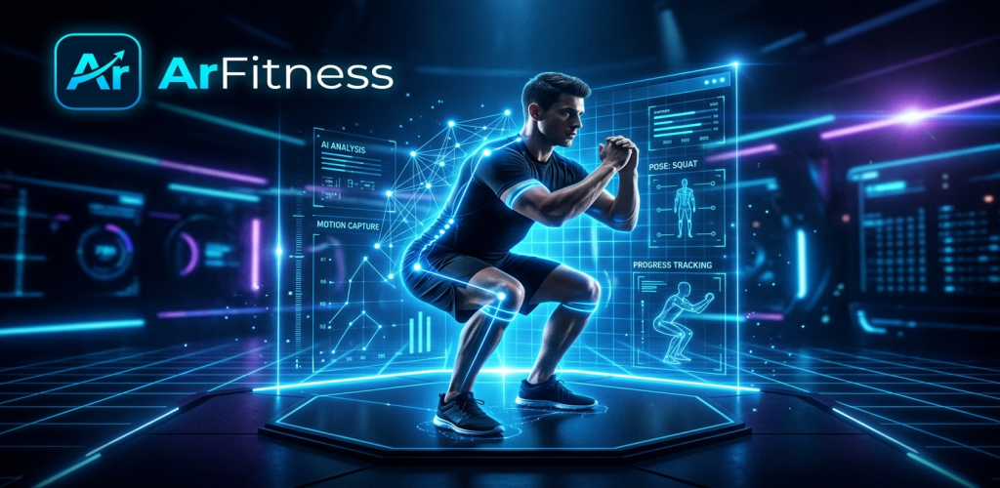

# ArFitness

**Kameranla egzersizini takip et, tekrarlarını say ve formun için anlık ipuçları al.** ArFitness, Android telefonunun kamerasıyla hareketini analiz eden ve antrenman geçmişini cihazında saklayan bir fitness uygulamasıdır.

[](https://play.google.com/store/apps/details?id=com.enes.arfitness&hl=tr)



## Neler yapabilirsin?

- **15 egzersizde hareket takibi:** Squat, şınav, lunge, plank, biceps curl, shoulder press ve daha fazlası.
- **Tekrar ve süre sayımı:** Egzersiz sırasında canlı sayaç, sesli ve titreşimli bildirim seçenekleri.
- **Form ipuçları:** Hareket analizine göre ekranda egzersize özel yönlendirmeler.
- **Egzersiz rehberleri:** Hareket animasyonları, hedef kas grupları ve uygulama içi talimatlar.
- **Antrenman geçmişi:** Tamamlanan antrenmanların süresi, tekrarları ve form puanı cihazda saklanır.

## Gizlilik

Kamera görüntüleri egzersiz sırasında cihaz üzerinde işlenir; uygulama bunları kaydetmez veya sunucuya göndermez. Antrenman geçmişi ve profil bilgileri cihazda saklanır. Ayrıntılar için [Gizlilik Politikası](privacy_policy.md) sayfasına bak.

## Kullanılan teknolojiler

- Kotlin, AndroidX, MVVM, ViewBinding
- CameraX ve Google ML Kit Pose Detection
- Room, Hilt, Coroutines, Navigation Component
- Egzersize özel hareket analizörleri ve tekrar sayımı

## Geliştirme

Projeyi Android Studio'da açıp `app` yapılandırmasını çalıştırabilirsin. Komut satırından debug APK oluşturmak için:

```powershell
.\gradlew.bat assembleDebug
```

## Geri bildirim

Bir hata bulduysan veya geliştirme önerin varsa [GitHub Issues](https://github.com/EnesKaraca44/ArFitness/issues) üzerinden paylaşabilirsin. Uygulamayı denemek için [Google Play sayfasını aç](https://play.google.com/store/apps/details?id=com.enes.arfitness&hl=tr).

---

**ArFitness** is an Android workout companion that uses the phone camera for exercise tracking, rep counting and form cues. Workout history and profile data are stored locally on the device.
